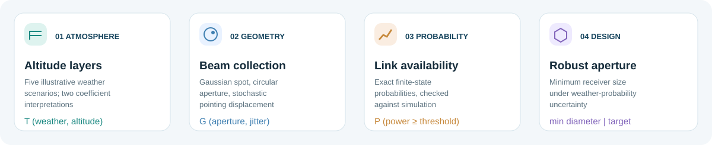
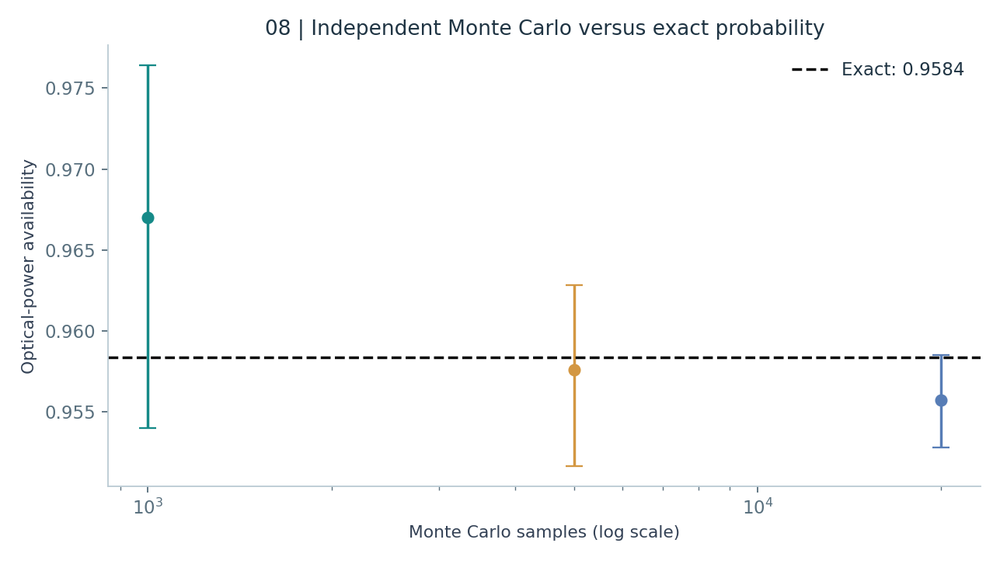

# Atmospheric-Model Sensitivity in Ground-to-Air FSO Receiver Design

<p align="center"><strong>Nishat Yasmin Anika</strong><br>
Department of Electronics and Communication Engineering<br>
Khulna University of Engineering &amp; Technology (KUET), Bangladesh</p>

<p align="center">
  <a href="https://github.com/Nishat-Yasmin-Anika/ground-to-air-fso-link-design/actions/workflows/python-tests.yml"></a>
  <a href="https://colab.research.google.com/github/Nishat-Yasmin-Anika/ground-to-air-fso-link-design/blob/main/notebooks/FSO_Link_Design_Colab.ipynb"></a>
  <a href="LICENSE"></a>
</p>

[Abstract](#abstract) · [Method](#model-and-method) · [Results](#results-and-discussion) · [Verification](#numerical-verification) · [Reproduction](#reproduction) · [References](#references)

<p align="center"></p>

## Abstract

<p align="justify">This study examines how the choice of atmospheric attenuation model affects receiver aperture sizing in ground-to-air free-space optical (FSO) links. The calculation combines altitude-dependent atmospheric layers, the exact collection fraction of a displaced Gaussian beam and random pointing errors. Uncertainty in weather-scenario probabilities is represented by a total-variation (TV) ambiguity set.</p>

<p align="justify">For a 3 km vertical link with a 92% received-power availability target and 15 µrad per-axis angular jitter, the required nominal receiver diameter is 9.47 cm when the published attenuation coefficients are interpreted in dB/km and 21.95 cm when the exponential equation in the source is used directly. At a TV radius of 0.08, the second interpretation gives an availability ceiling of 89.2%. The target is then infeasible at any finite aperture. Quadrature, linear programming and Monte Carlo simulation are used to verify the numerical calculations.</p>

**Keywords:** Free-space optics, atmospheric attenuation, pointing errors, Gaussian beam collection, receiver aperture, distributionally robust optimization.

## Research context

<p align="justify">Erdogan et al. [1] describe attenuation through horizontal atmospheric layers. Their tables label the coefficients in dB/km, while their transmittance equation uses a natural exponential. Using the printed values in these two ways gives different power transmittances. Here, both interpretations are evaluated without changing the source coefficients. Two additional cases examine the clear-weather layer described in the source text and a separate radiation-fog attenuation relation [2].</p>

<p align="justify">The optical model is informed by work on pointing errors [3] and multilayer airborne FSO links [4]. The question is whether a receiver sized under a nominal weather distribution still meets its power threshold when the distribution is perturbed. Total variation [5] provides the uncertainty constraint. The analysis does not attempt to reproduce the source's atmospheric calibration.</p>

## Model and method

<p align="center"></p>

*Fig. 1. Calculation sequence for the receiver design problem.*

### Atmospheric attenuation

For a receiver at altitude H and zenith angle θ, the slant path in the flat-layer approximation is H sec θ. Each intersected layer contributes its traversed distance to the integrated printed coefficient Q. The two power-transmittance interpretations are

```math
Q=\sum_j c_jd_j
```

```math
T_{\mathrm{dB}}=10^{-Q/10},\qquad T_{\mathrm{exp}}=e^{-Q}.
```

Here, the layer distance d is measured in kilometres. The units of Q depend on the interpretation. The literal dB/km conversion is the primary case; the exponential form is retained for comparison with the printed equation in [1].

### Optical collection and pointing

<p align="justify">Received optical power is the product of transmitted power, optical efficiency, atmospheric transmittance and the fraction collected by the circular aperture. The exact collection fraction is given by a noncentral chi-square cumulative distribution function with two degrees of freedom.</p>

```math
P_r=P_t\eta T G(a,w,r)
```

```math
G(a,w,r)=F_{\chi'^2_2}\left(\frac{4a^2}{w^2};\frac{4r^2}{w^2}\right).
```

The variables a, w and r denote aperture radius, Gaussian beam radius and radial pointing displacement, respectively. Independent zero-mean Gaussian pointing components with equal variance give a Rayleigh distribution for r. For each atmospheric state, the maximum displacement satisfying the received-power threshold is found numerically.

### Aperture optimization

Let Aᵢ(a) be the availability conditional on weather scenario i. Let p be the nominal probability vector and q an alternative vector. The ambiguity set is

```math
\mathcal U_\rho=\left\{q\geq0:\ \sum_i q_i=1,\quad \frac12\sum_i\lvert q_i-p_i\rvert\leq\rho\right\}.
```

The minimum aperture is sought subject to the worst-case availability constraint:

```math
\begin{aligned}
\min_a\quad &a \\
\text{subject to}\quad &\min_{q\in\mathcal U_\rho}\sum_i q_i A_i(a)\geq A_{\mathrm{target}},\\
&0.025\leq a\leq0.50\quad\text{(metres)}.
\end{aligned}
```

<p align="justify">The inner problem is solved by transferring probability from scenarios with higher availability to those with lower availability. The outer search uses bisection because collection increases with aperture radius. An atmospheric ceiling distinguishes targets that fail within the search interval from those that cannot be met at any finite aperture.</p>

[Detailed mathematical derivations](docs/MATHEMATICAL_DERIVATIONS.md) · [Technical note](docs/TECHNICAL_NOTE.md)

<details>
<summary>Reference simulation parameters</summary>

| Parameter | Assumed value |
|---|---:|
| Wavelength | 1550 nm |
| Receiver altitude | 3 km |
| Zenith angle | 0° |
| Transmitted optical power | 50 mW |
| Optical efficiency | 0.70 |
| Beam waist radius | 25 mm |
| Divergence half-angle | 55 µrad |
| Per-axis angular jitter (standard deviation) | 15 µrad |
| Received-power threshold | 2 mW |
| Availability target | 0.92 |
| Reference TV radius | 0.04 |

The assumed scenario probabilities for clear weather, pollution, fog, rain and snow are 0.76, 0.10, 0.07, 0.04 and 0.03, respectively. These are illustrative probabilities, not estimates from historical weather data.

</details>

## Results and discussion

Table 1 reports the minimum receiver diameter for a 92% probability of meeting or exceeding the assumed 2 mW threshold in the reference link.

*Table 1. Minimum receiver diameter (cm) under alternative atmospheric assumptions.*

| Atmospheric case | Nominal | ρ = 0.04 | ρ = 0.08 |
|---|---:|---:|---:|
| Table II, literal dB/km | 9.47 | 11.82 | 13.62 |
| Table II, exponential interpretation | 21.95 | 27.01 | Infeasible |
| Clear-weather prose alternative | 9.42 | 11.75 | 13.62 |
| Radiation-fog stress case | 15.65 | Infeasible | Infeasible |

<p align="justify">Under literal dB/km conversion, increasing the TV radius from zero to 0.04 raises the required diameter from 9.47 to 11.82 cm. The corresponding change under the exponential interpretation is from 21.95 to 27.01 cm. At ρ = 0.08, the latter has a ceiling of 89.2%, below the target. The radiation-fog case also falls below the target at ρ = 0.04, with a ceiling of 89%. These cases cannot meet 92% at any finite aperture under the stated assumptions.</p>

[](results/figures/11_model_and_target_sensitivity.svg)

*Fig. 2. Receiver aperture requirements across atmospheric cases and availability targets. [Vector figure](results/figures/11_model_and_target_sensitivity.svg).*

The optical parameters remain fixed in Table 1. The differences therefore arise from the atmospheric assumptions and the uncertainty in weather probabilities, rather than changes in transmitter power or beam geometry. The comparison does not establish which coefficient interpretation is physically correct.

<details>
<summary>Additional results: pointing jitter and aperture size</summary>

[](results/figures/04_minimum_aperture_frontier.svg)

*Fig. 3. Minimum receiver diameter versus per-axis angular jitter.*

[](results/figures/03_availability_vs_aperture.svg)

*Fig. 4. Received-power availability versus aperture size.*

</details>

[Complete results gallery (12 figures, 11 CSV tables and metadata)](results/README.md) · [Source data for Table 1](results/tables/09_model_and_target_sensitivity.csv)

## Numerical verification

<p align="justify">Independent Bessel and Cartesian quadrature check the Gaussian aperture integral. A separately formulated linear program checks the TV probability-transfer solution. Monte Carlo simulations draw weather states and Gaussian pointing displacements directly; Wilson intervals quantify sampling uncertainty in the estimated success probabilities.</p>

[](results/figures/08_monte_carlo_validation.svg)

*Fig. 5. Monte Carlo estimates and analytic availability.*

<details>
<summary>Independent aperture integral comparison</summary>

[](results/figures/01_aperture_integral_validation.svg)

*Fig. 6. Numerical agreement between aperture integration methods.*

</details>

The version 4.1.0 test suite contains 44 tests. GitHub Actions regenerates the full experiments and compares the 11 numerical tables against the committed reference results, with execution time excluded. SHA-256 hashes are used to verify the generated artifacts and generating source files.

[Verification methods and computational complexity](docs/COMPLEXITY_AND_VERIFICATION.md) · [Verification history](https://github.com/Nishat-Yasmin-Anika/ground-to-air-fso-link-design/actions)

## Limitations

<p align="justify">The atmospheric coefficients have not been calibrated against local measurements. The scenario probabilities, layer independence, optical parameters and TV radius are assumptions. Turbulence, scintillation, receiver field-of-view effects, detector noise and temporal tracking dynamics are omitted. Availability is the probability of meeting a received-optical-power threshold, not measured uptime or bit-error-rate performance. The radiation-fog relation is used as a separate sensitivity case and has not been validated for this airborne geometry.</p>

## Reproduction

[Open the standalone notebook in Google Colab](https://colab.research.google.com/github/Nishat-Yasmin-Anika/ground-to-air-fso-link-design/blob/main/notebooks/FSO_Link_Design_Colab.ipynb) and select **Runtime → Run all**. The notebook runs on a CPU, generates its own source files, executes the tests and full experiments and exports the project. A Google Drive mount is not required.

<details>
<summary>Local execution and regression comparison (Linux)</summary>

```bash
python -m pip install -r requirements.txt -r requirements-lock.txt
python -m unittest discover -s tests -v
python build_notebook.py --check
python verify_manifest.py

REF=$(mktemp -d)
cp -r results/tables "$REF/tables"
FAST_MODE=0 python run_study.py
python compare_results.py "$REF/tables" results/tables
python verify_manifest.py
```

Run `python build_notebook.py` after editing any embedded source or documentation. Full mode uses 100,000 samples in the largest Monte Carlo runs. See the [update instructions](UPDATE_GITHUB.md).

</details>

| Resource | Contents |
|---|---|
| [src/](src/) | Atmospheric and optical models |
| [run_study.py](run_study.py) | Experiments and figure generation |
| [tests/](tests/) | Mathematical and regression tests |
| [compare_results.py](compare_results.py) | Numerical table comparison |
| [notebooks/](notebooks/) | Standalone Colab notebook |
| [results/](results/README.md) | Figures, tables and metadata |
| [docs/](docs/) | Derivations, technical notes and source mapping |

## References

1. E. Erdogan et al., “Modeling Atmospheric Attenuation in Vertical FSO Links: An Altitude-Aware Piecewise Framework,” *IEEE Vehicular Technology Magazine*, 2026. [DOI](https://doi.org/10.1109/MVT.2026.3687349) · [Author manuscript](https://arxiv.org/html/2604.18207v1).
2. M. Al Naboulsi, H. Sizun and F. de Fornel, “Fog attenuation prediction for optical and infrared waves,” *Optical Engineering*, vol. 43, pp. 319–329, 2004. See the [source map](docs/SOURCE_MAP.md) for the coefficient relation, units and applicability.
3. A. A. Farid and S. Hranilovic, “Outage Capacity Optimization for Free-Space Optical Links with Pointing Errors,” 2007. [DOI](https://doi.org/10.1109/JLT.2007.899174).
4. M. Elamassie and M. Uysal, “Multi-Layer Airborne FSO Systems: Performance Analysis and Optimization,” 2025. [DOI](https://doi.org/10.1109/TCOMM.2024.3471995).
5. H. Rahimian and S. Mehrotra, “Frameworks and Results in Distributionally Robust Optimization,” 2022. [DOI](https://doi.org/10.5802/ojmo.15).

The [source-to-implementation map](docs/SOURCE_MAP.md) records the provenance of coefficients and equations and identifies the additional assumptions used in this study.

## Citation and license

See [CITATION.cff](CITATION.cff) for the software citation. Cite the original scientific publications separately when using their models. The code is distributed under the [MIT License](LICENSE).

AI tools assisted implementation and review. The author is responsible for the scientific assumptions and findings.
