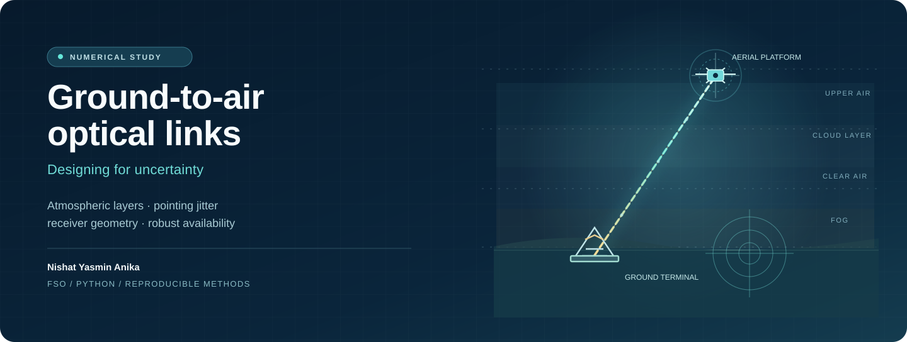
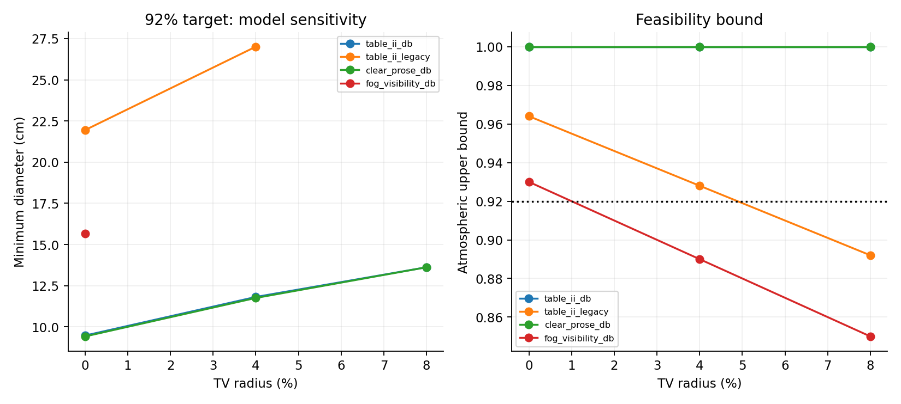
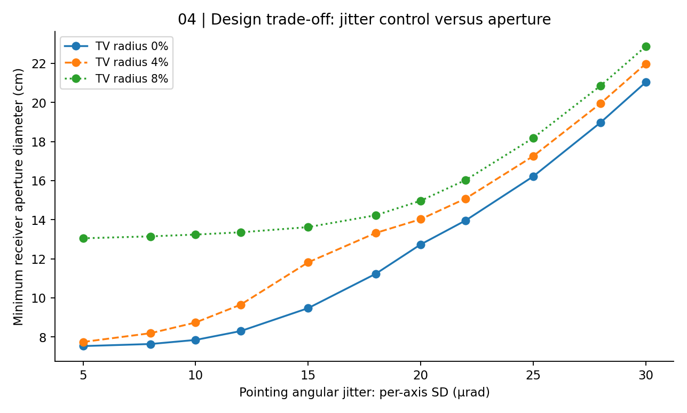
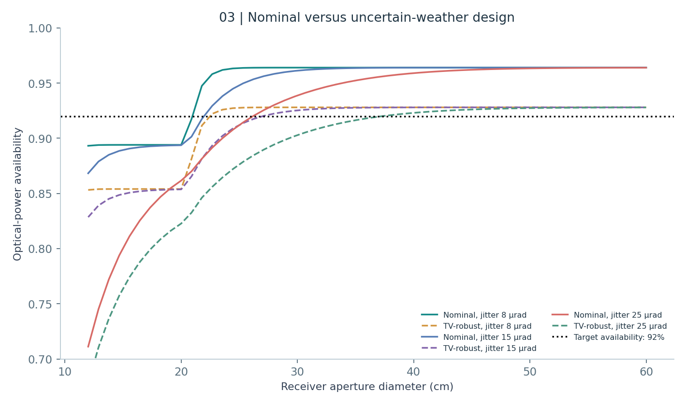
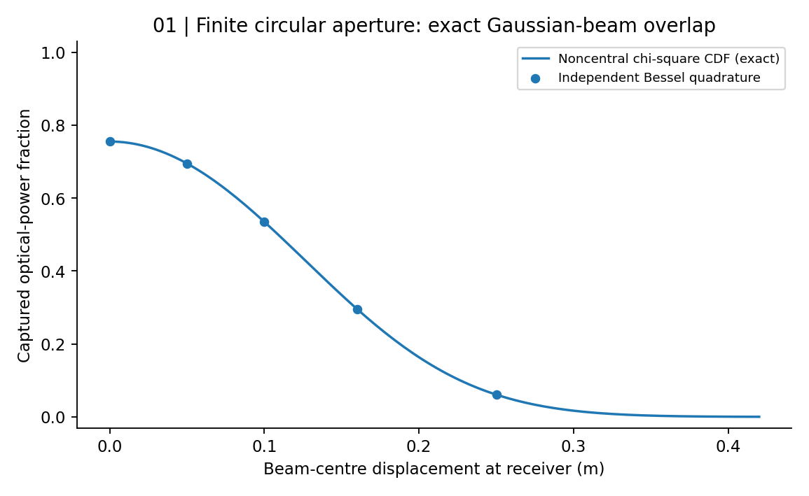

<p align="center">
  
</p>

# Atmospheric-Model Sensitivity in Ground-to-Air FSO Receiver Design

**Nishat Yasmin Anika**  
Electronics and Communication Engineering (ECE)  
Khulna University of Engineering & Technology (KUET)

[](https://github.com/Nishat-Yasmin-Anika/ground-to-air-fso-link-design/actions)
[](https://colab.research.google.com/github/Nishat-Yasmin-Anika/ground-to-air-fso-link-design/blob/main/notebooks/FSO_Link_Design_Colab.ipynb)
[](LICENSE)

## 1. Research Overview

This computational study investigates the sensitivity of
ground-to-air free-space optical (FSO) receiver aperture
design to atmospheric attenuation, Gaussian beam collection,
pointing displacement and weather probability uncertainty.

The objective is to determine the minimum receiver aperture
required to satisfy a specified received-optical-power
availability target under nominal and uncertain weather
distributions.

The study is a research portfolio and numerical method
demonstration. It is not an experimentally calibrated
communication system or a claim of algorithmic novelty.

## 2. Research Questions

- How does atmospheric model interpretation affect
  receiver aperture requirements?
- How does pointing jitter influence optical collection
  and modeled link availability?
- What is the aperture cost of robustness against weather
  probability uncertainty?
- Under what atmospheric conditions does the specified
  availability target become infeasible?

## 3. Mathematical Framework

The received optical power is modeled as

$$
P_r = P_t \eta T_{\mathrm{atm}} G(a,r)
$$

where:

| Symbol | Definition |
|---|---|
| $P_t$ | Transmitted optical power |
| $\eta$ | Optical efficiency |
| $T_{\mathrm{atm}}$ | Atmospheric power transmittance |
| $G(a,r)$ | Gaussian beam collection fraction |
| $a$ | Receiver aperture radius |
| $r$ | Beam displacement |

The minimum aperture is obtained subject to a worst-case
availability constraint over a total-variation probability
ambiguity set.

The atmospheric model is evaluated under explicitly
separated attenuation coefficient interpretations.
Neither interpretation is assumed to establish the
physical accuracy of the original printed coefficients.

## 4. Research Methodology

<p align="center">
  
</p>

The computational framework combines:

1. Altitude-dependent layered atmospheric attenuation.
2. Exact circular-aperture Gaussian beam integration.
3. Independent Gaussian pointing displacement components.
4. Conditional received-power availability.
5. Total-variation distributionally robust optimization.
6. Independent quadrature, linear programming and
   Monte Carlo verification.

## 5. Reference Simulation Parameters

| Parameter | Illustrative value |
|---|---:|
| Optical wavelength | 1550 nm |
| Receiver altitude | 3 km |
| Zenith angle | 0 degrees |
| Transmitter power | 50 mW |
| Optical efficiency | 0.70 |
| Beam waist radius | 25 mm |
| Divergence half-angle | 55 microradians |
| Per-axis pointing jitter | 15 microradians |
| Received-power threshold | 2 mW |
| Availability target | 92% |
| Reference TV ambiguity radius | 0.04 |

These parameters are illustrative and are not
specifications of a validated hardware system.

## 6. Principal Results

Minimum receiver aperture diameter for the 92%
modeled availability target:

| Atmospheric model | Nominal | TV = 0.04 | TV = 0.08 |
|---|---:|---:|---:|
| Literal dB/km | 9.47 cm | 11.82 cm | 13.62 cm |
| Legacy exponential | 21.95 cm | 27.01 cm | Infeasible |
| Clear-weather prose alternative | 9.42 cm | 11.75 cm | 13.62 cm |
| Radiation-fog stress case | 15.65 cm | Infeasible | Infeasible |

These results demonstrate that atmospheric model
interpretation can substantially change the calculated
aperture requirement and feasibility conclusion.

They are conditional model predictions, not measured
operational availability or hardware recommendations.

### 6.1. Atmospheric Model and Target Sensitivity



### 6.2. Receiver Aperture and Pointing Jitter



### 6.3. Availability and Aperture Size



### 6.4. Independent Numerical Verification



### 6.5. Monte Carlo Verification


See the [complete results gallery](results/README.md)
for all figures, numerical tables and metadata.

## 7. Mathematical and Numerical Verification

Verification includes:

- Analytical Gaussian aperture identities.
- Independent Bessel and Cartesian numerical integration.
- Independent linear programming verification.
- Minimum-aperture feasibility checks.
- Zero-jitter and threshold-equality edge cases.
- Published atmospheric coefficient transcription checks.
- Multi-seed Monte Carlo simulations.
- Invalid-input regression tests.
- SHA-256 result and generating-source integrity checks.
- Automated comparison of regenerated numerical tables.

The automated test suite includes 44 mathematical and regression tests.
GitHub Actions provides the status of the committed version.

## 8. Repository Structure

```text
src/          Canonical atmospheric and optical models
tests/        Mathematical and regression tests
notebooks/    Standalone Google Colab notebook
results/      Figures, CSV tables and metadata
docs/         Technical notes and reference documentation
assets/       Project illustrations
run_study.py  Experiment generation
```

## 9. Reproducibility

### Google Colab

Open the notebook using the Colab badge above.
Select Runtime > Run all.

No Google Drive mount or GPU is required.

The notebook generates the source files, executes the
tests, runs the experiments and exports a GitHub update ZIP.

### Local Python

```bash
python -m pip install -r requirements.txt
python -m unittest discover -s tests -v
python run_study.py
python verify_manifest.py
python build_notebook.py
```

Set the environment variable `FAST_MODE=0` for the
full Monte Carlo configuration.

The notebook is generated from canonical Python files.
Do not edit the generated notebook independently.

## 10. Scientific Limitations

- The atmospheric coefficient conventions require further
  verification against their original derivation.
- Weather probabilities and TV ambiguity radii are illustrative.
- Optical parameters and receiver threshold are hypothetical.
- Atmospheric turbulence and scintillation are not modeled.
- Receiver field of view and detector noise are excluded.
- BER and communication-level outage are not evaluated.
- No experimental hardware validation has been performed.
- The radiation-fog comparison is a sensitivity case,
  not validation of the airborne atmospheric model.

These limitations define potential directions for
future supervised research.

## 11. Documentation and References

- [Detailed mathematical derivations](docs/MATHEMATICAL_DERIVATIONS.md)
- [Technical note](docs/TECHNICAL_NOTE.md)
- [Scientific source map](docs/SOURCE_MAP.md)
- [Complexity and verification](docs/COMPLEXITY_AND_VERIFICATION.md)
- [Complete results](results/README.md)
- [Update instructions](UPDATE_GITHUB.md)

Principal atmospheric reference:

Erdogan et al., Modeling Atmospheric Attenuation in
Vertical FSO Links: An Altitude-Aware Piecewise Framework,
IEEE Vehicular Technology Magazine, 2026.

DOI: https://doi.org/10.1109/MVT.2026.3687349

Further references and applicability qualifications
are documented in the scientific source map.

## 12. License and Attribution

Released under the [MIT License](LICENSE).

AI tools assisted implementation and review. The author
is responsible for understanding, reviewing and approving
the scientific assumptions and reported findings.


## Citation

If you use this computational framework, please cite the
software using [CITATION.cff](CITATION.cff).

The original scientific publications underlying the models
should be cited separately, as documented in the
[scientific source map](docs/SOURCE_MAP.md).

