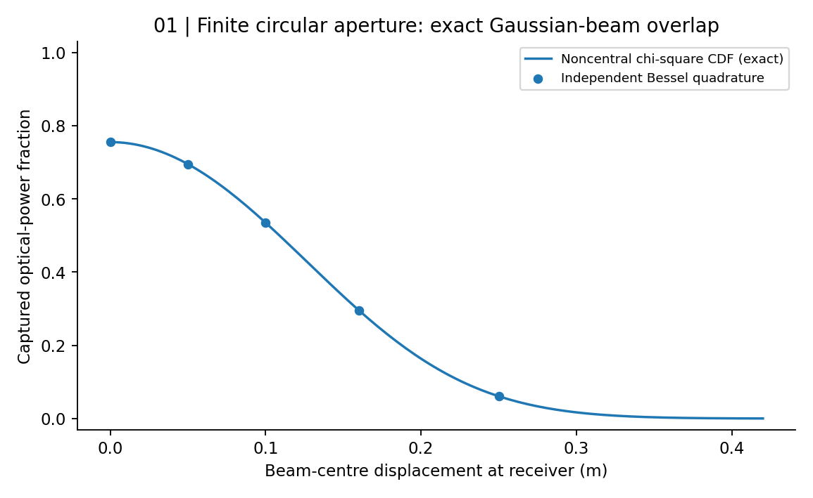
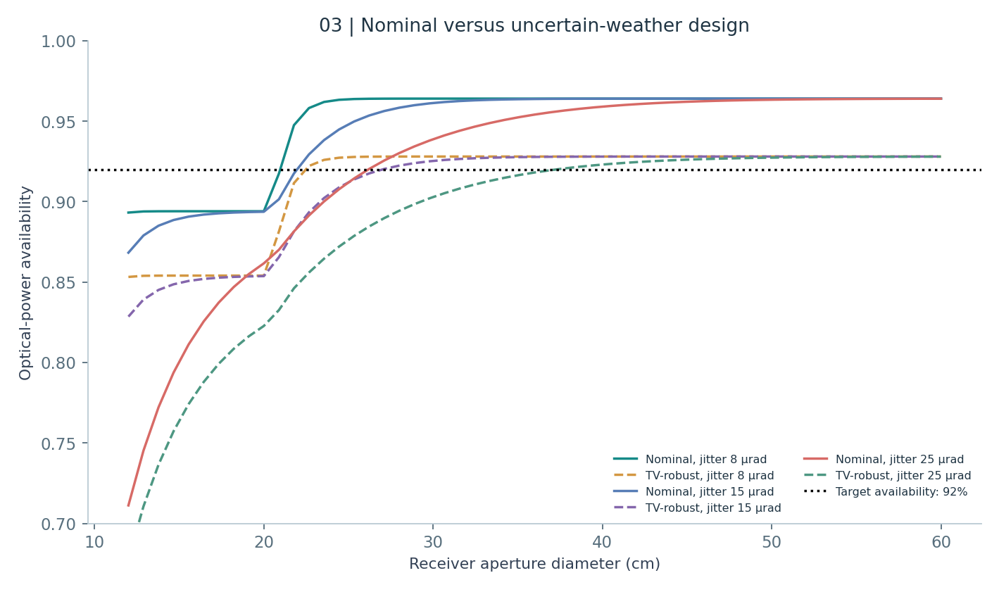
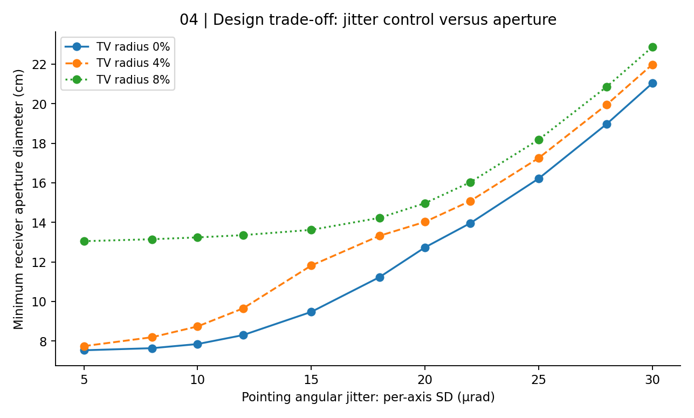
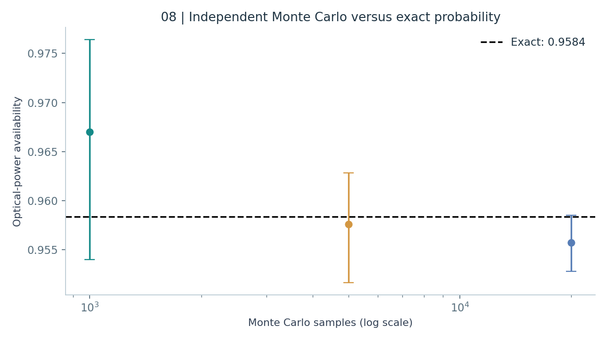
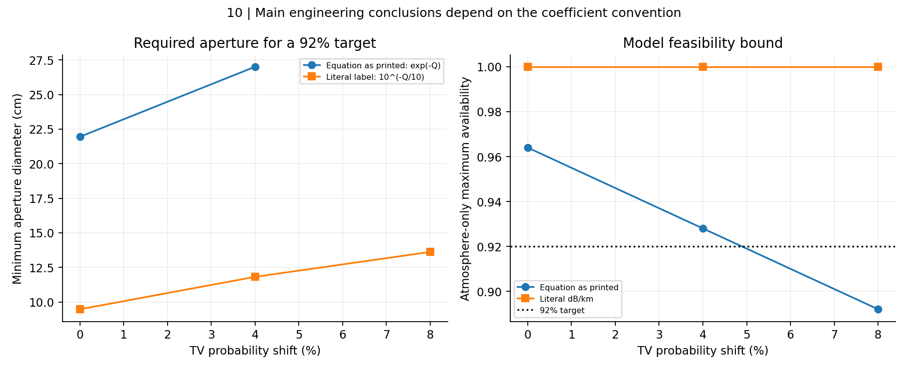

# Results gallery

These plots and CSV tables are generated by [`run_study.py`](../run_study.py) and are browsable directly on GitHub. **All 10 figures are displayed below**; click an image to open its PNG, or select SVG for a vector version. All numbers are conditional on the assumptions in [`run_config.json`](metadata/run_config.json), including hypothetical weather frequencies and device parameters.

[← Project overview](../README.md) · [Technical note](../docs/TECHNICAL_NOTE.md) · [Run configuration](metadata/run_config.json)

## Figures — all outputs

<table>
<tr>
<td width="50%" valign="top">
  <a href="figures/01_aperture_integral_validation.png"></a>
  <strong>01 / Aperture integral verification</strong>
  <p>Checks the noncentral chi-squared aperture formula against independent numerical integration.</p>
  <a href="figures/01_aperture_integral_validation.png">PNG</a> · <a href="figures/01_aperture_integral_validation.svg">SVG</a>
</td>
<td width="50%" valign="top">
  <a href="figures/02_atmospheric_unit_interpretations.png"></a>
  <strong>02 / Attenuation-unit interpretations</strong>
  <p>Compares equation-as-printed attenuation with the literal decibel-per-kilometre interpretation.</p>
  <a href="figures/02_atmospheric_unit_interpretations.png">PNG</a> · <a href="figures/02_atmospheric_unit_interpretations.svg">SVG</a>
</td>
</tr>
</table>

<table>
<tr>
<td width="50%" valign="top">
  <a href="figures/03_availability_vs_aperture.png"></a>
  <strong>03 / Availability versus aperture</strong>
  <p>Shows modeled received-power availability as the receiving aperture changes.</p>
  <a href="figures/03_availability_vs_aperture.png">PNG</a> · <a href="figures/03_availability_vs_aperture.svg">SVG</a>
</td>
<td width="50%" valign="top">
  <a href="figures/04_minimum_aperture_frontier.png"></a>
  <strong>04 / Minimum-aperture frontier</strong>
  <p>Compares nominal and robust aperture requirements across pointing-jitter values.</p>
  <a href="figures/04_minimum_aperture_frontier.png">PNG</a> · <a href="figures/04_minimum_aperture_frontier.svg">SVG</a>
</td>
</tr>
</table>

<table>
<tr>
<td width="50%" valign="top">
  <a href="figures/05_weather_probability_shift.png"></a>
  <strong>05 / Weather-distribution sensitivity</strong>
  <p>Shows how changes to the assumed weather probabilities influence conservative availability.</p>
  <a href="figures/05_weather_probability_shift.png">PNG</a> · <a href="figures/05_weather_probability_shift.svg">SVG</a>
</td>
<td width="50%" valign="top">
  <a href="figures/06_design_feasibility_map.png"></a>
  <strong>06 / Design feasibility map</strong>
  <p>Indicates where the specified aperture and uncertainty settings meet the illustrative availability target.</p>
  <a href="figures/06_design_feasibility_map.png">PNG</a> · <a href="figures/06_design_feasibility_map.svg">SVG</a>
</td>
</tr>
</table>

<table>
<tr>
<td width="50%" valign="top">
  <a href="figures/07_ablation.png"></a>
  <strong>07 / Ablation comparison</strong>
  <p>Separates the effects of atmospheric assumptions and pointing jitter.</p>
  <a href="figures/07_ablation.png">PNG</a> · <a href="figures/07_ablation.svg">SVG</a>
</td>
<td width="50%" valign="top">
  <a href="figures/08_monte_carlo_validation.png"></a>
  <strong>08 / Monte Carlo cross-check</strong>
  <p>Compares exact probabilities with sampled outcomes and Wilson score intervals.</p>
  <a href="figures/08_monte_carlo_validation.png">PNG</a> · <a href="figures/08_monte_carlo_validation.svg">SVG</a>
</td>
</tr>
</table>

<table>
<tr>
<td width="50%" valign="top">
  <a href="figures/09_atmospheric_feasibility_ceiling.png"></a>
  <strong>09 / Atmospheric feasibility ceiling</strong>
  <p>Gives a conditional upper bound under the equation-as-printed attenuation convention.</p>
  <a href="figures/09_atmospheric_feasibility_ceiling.png">PNG</a> · <a href="figures/09_atmospheric_feasibility_ceiling.svg">SVG</a>
</td>
<td width="50%" valign="top">
  <a href="figures/10_optimization_convention_sensitivity.png"></a>
  <strong>10 / Full design convention audit</strong>
  <p>Re-solves receiver sizing under both attenuation coefficient interpretations.</p>
  <a href="figures/10_optimization_convention_sensitivity.png">PNG</a> · <a href="figures/10_optimization_convention_sensitivity.svg">SVG</a>
</td>
</tr>
</table>

## Data tables — all CSV outputs

Click any CSV to view the numerical data on GitHub or download the raw file.

| File | Description |
|:--|:--|
| [`01_weather_scenarios_and_conventions.csv`](tables/01_weather_scenarios_and_conventions.csv) | Weather scenarios and transmittance under both coefficient conventions |
| [`02_minimum_aperture_frontier.csv`](tables/02_minimum_aperture_frontier.csv) | Nominal and robust receiver diameters over pointing-jitter settings |
| [`03_tv_radius_sensitivity.csv`](tables/03_tv_radius_sensitivity.csv) | Worst-case modeled availability by total-variation radius |
| [`04_ablation.csv`](tables/04_ablation.csv) | Effect of simplifying individual model components |
| [`05_monte_carlo_verification.csv`](tables/05_monte_carlo_verification.csv) | Monte Carlo estimate, uncertainty interval and local runtime |
| [`06_alternate_illustrative_weather_priors.csv`](tables/06_alternate_illustrative_weather_priors.csv) | Sensitivity to different hypothetical weather priors |
| [`07_atmospheric_feasibility_ceiling.csv`](tables/07_atmospheric_feasibility_ceiling.csv) | Atmosphere-only upper bound and conditional infeasibility |
| [`08_optimization_convention_sensitivity.csv`](tables/08_optimization_convention_sensitivity.csv) | Receiver sizing and feasibility under both attenuation interpretations |

## Reproducibility metadata

| File | Contents |
|:--|:--|
| [`run_config.json`](metadata/run_config.json) | Declared parameter values and modeling assumptions |
| [`environment.json`](metadata/environment.json) | Interpreter and package versions |
| [`runtime.json`](metadata/runtime.json) | Local execution time, not a guaranteed runtime |
| [`manifest.json`](metadata/manifest.json) | Sizes and SHA-256 hashes of result files at generation time |

## How to interpret the figures

- **Figure 10 controls the physical interpretation.** The paper's equation-as-printed attenuation convention and the literal dB/km convention give different numerical receiver requirements. Neither has been calibrated here against measured atmospheric transmission.
- **Figure 09 is convention-specific.** Its atmospheric feasibility threshold applies only under the equation-as-printed convention, not universally.
- **The outputs are modeled optical-power availability, not measured uptime or bit-error-rate performance.** The project excludes turbulence scintillation, detector noise, dynamic tracking and empirically estimated weather priors.

To regenerate everything locally, start from the repository root:

```bash
python -m pip install -r requirements.txt
python -m unittest discover -s tests -v
python run_study.py
```

The self-contained [Google Colab notebook](../notebooks/FSO_Link_Design_Colab.ipynb) regenerates the same result hierarchy and offers a ZIP export. The CSV files are also readable directly in Excel or pandas.
