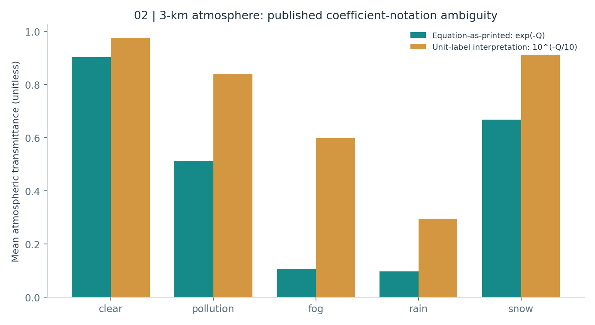
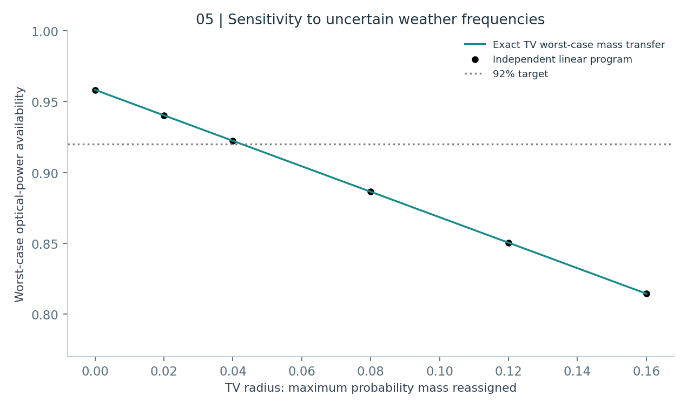
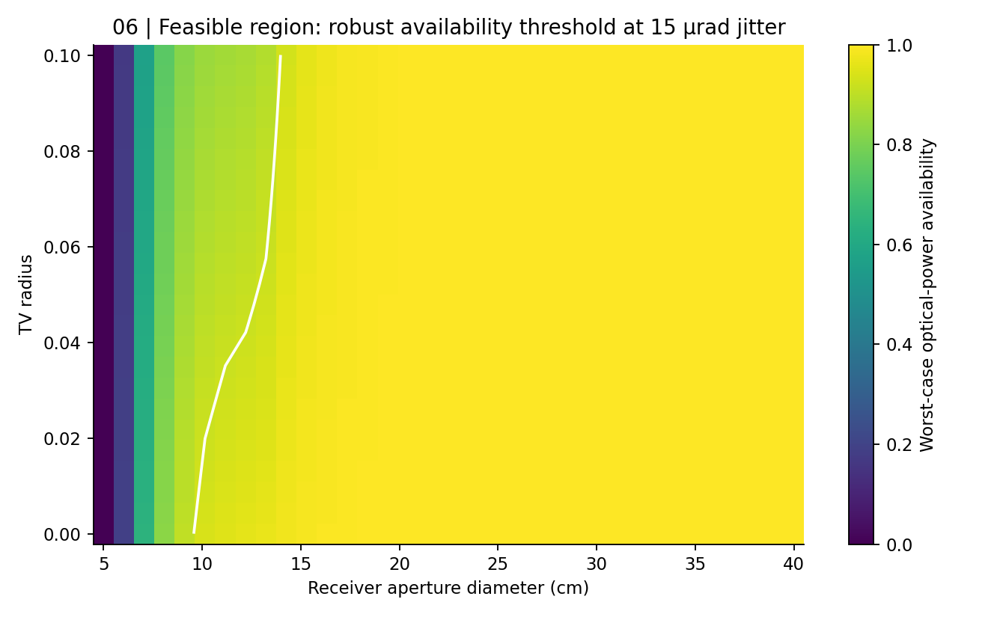
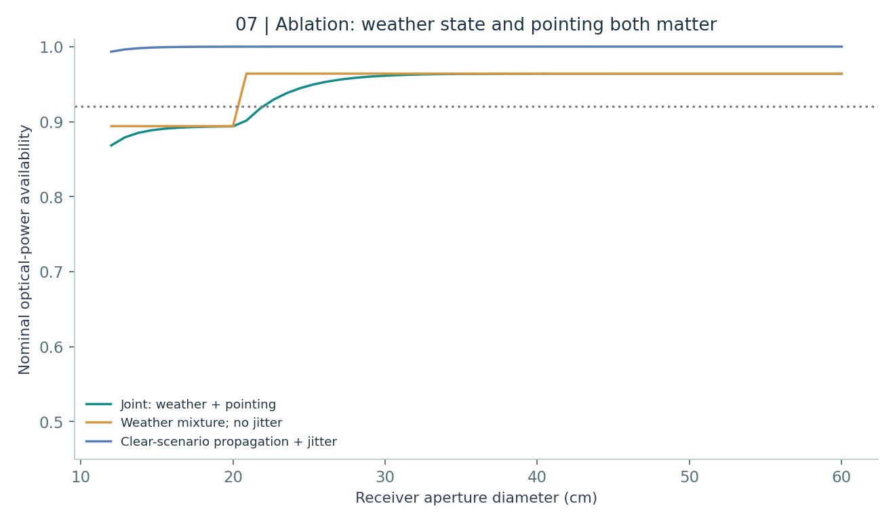
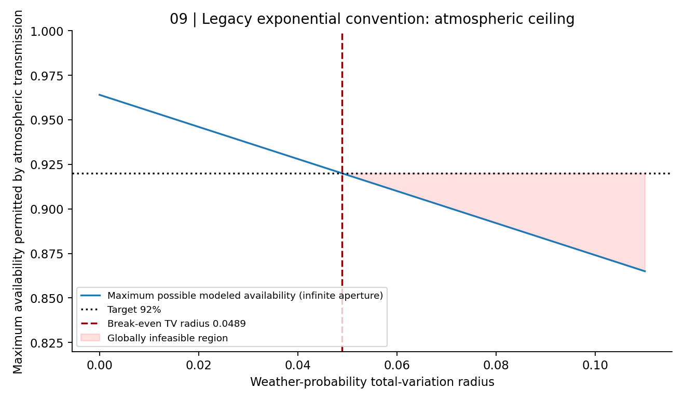
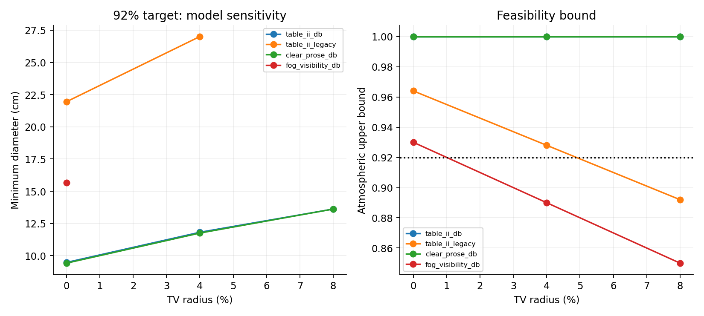
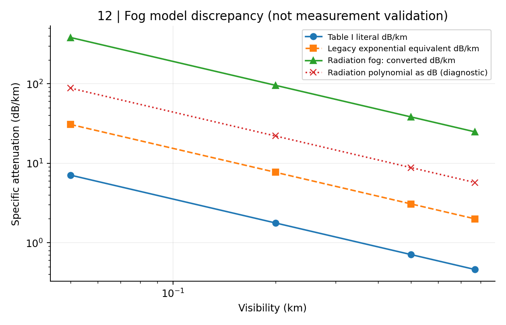

# Simulation Results

All figures and numerical tables are generated automatically
by `run_study.py`.

These results represent conditional computational predictions,
not experimental measurements.

[Return to project overview](../README.md)

## Figure Gallery

### Independent Gaussian Aperture Integration

Comparison of analytical and independent numerical integration.

[PNG](figures/01_aperture_integral_validation.png) |
[Vector SVG](figures/01_aperture_integral_validation.svg)

---

### Atmospheric Coefficient Interpretations

Comparison of atmospheric attenuation conventions.

[PNG](figures/02_atmospheric_unit_interpretations.png) |
[Vector SVG](figures/02_atmospheric_unit_interpretations.svg)

---

### Availability versus Aperture

Relationship between aperture size and modeled availability.

[PNG](figures/03_availability_vs_aperture.png) |
[Vector SVG](figures/03_availability_vs_aperture.svg)

---

### Minimum Aperture Frontier

Receiver aperture requirements under pointing uncertainty.

[PNG](figures/04_minimum_aperture_frontier.png) |
[Vector SVG](figures/04_minimum_aperture_frontier.svg)

---

### Weather Probability Uncertainty

Sensitivity to alternative weather probability distributions.

[PNG](figures/05_weather_probability_shift.png) |
[Vector SVG](figures/05_weather_probability_shift.svg)

---

### Design Feasibility Map

Feasibility across the evaluated design parameter space.

[PNG](figures/06_design_feasibility_map.png) |
[Vector SVG](figures/06_design_feasibility_map.svg)

---

### Ablation Analysis

Individual contributions of selected channel-model components.

[PNG](figures/07_ablation.png) |
[Vector SVG](figures/07_ablation.svg)

---

### Monte Carlo Verification

Statistical comparison with analytical predictions.

[PNG](figures/08_monte_carlo_validation.png) |
[Vector SVG](figures/08_monte_carlo_validation.svg)

---

### Atmospheric Feasibility Ceiling

Atmosphere-limited upper bounds on modeled availability.

[PNG](figures/09_atmospheric_feasibility_ceiling.png) |
[Vector SVG](figures/09_atmospheric_feasibility_ceiling.svg)

---

### Optimization Convention Sensitivity

Aperture requirements under alternative coefficient conventions.

[PNG](figures/10_optimization_convention_sensitivity.png) |
[Vector SVG](figures/10_optimization_convention_sensitivity.svg)

---

### Atmospheric Model and Target Sensitivity

Comparison across atmospheric models and availability targets.

[PNG](figures/11_model_and_target_sensitivity.png) |
[Vector SVG](figures/11_model_and_target_sensitivity.svg)

---

### Fog Model Comparison

Conditional comparison of fog attenuation formulations.

[PNG](figures/12_fog_model_benchmark.png) |
[Vector SVG](figures/12_fog_model_benchmark.svg)

---

## Numerical Data

- [01 Weather Scenarios And Conventions](tables/01_weather_scenarios_and_conventions.csv)
- [02 Minimum Aperture Frontier](tables/02_minimum_aperture_frontier.csv)
- [03 Tv Radius Sensitivity](tables/03_tv_radius_sensitivity.csv)
- [04 Ablation](tables/04_ablation.csv)
- [05 Monte Carlo Verification](tables/05_monte_carlo_verification.csv)
- [06 Alternate Illustrative Weather Priors](tables/06_alternate_illustrative_weather_priors.csv)
- [07 Atmospheric Feasibility Ceiling](tables/07_atmospheric_feasibility_ceiling.csv)
- [08 Optimization Convention Sensitivity](tables/08_optimization_convention_sensitivity.csv)
- [09 Model And Target Sensitivity](tables/09_model_and_target_sensitivity.csv)
- [10 Fog Model Benchmark](tables/10_fog_model_benchmark.csv)
- [11 Multi Case Mc](tables/11_multi_case_mc.csv)

## Reproducibility Metadata

- [Execution environment](metadata/environment.json)
- [Experiment configuration](metadata/run_config.json)
- [Runtime information](metadata/runtime.json)
- [SHA-256 integrity manifest](metadata/manifest.json)

## Scientific Interpretation

The primary atmospheric interpretation uses the literal
dB/km conversion. Legacy exponential results are retained
for source traceability.

The atmospheric feasibility ceiling must be distinguished
from infeasibility within a finite aperture search interval.

Monte Carlo agreement supports internal numerical
consistency, not experimental validation.

The atmospheric coefficients, illustrative weather priors
and hypothetical hardware parameters require further
physical investigation.

[Technical note](../docs/TECHNICAL_NOTE.md) |
[Scientific source map](../docs/SOURCE_MAP.md) |
[Verification methodology](../docs/COMPLEXITY_AND_VERIFICATION.md)
